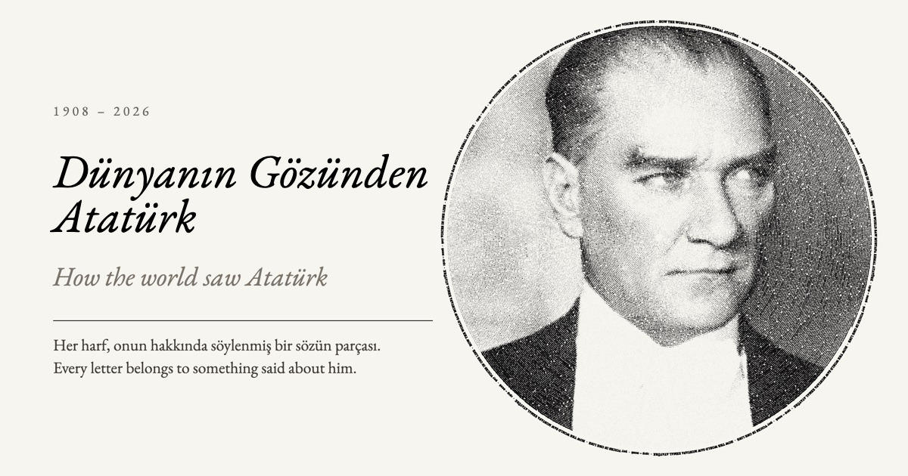
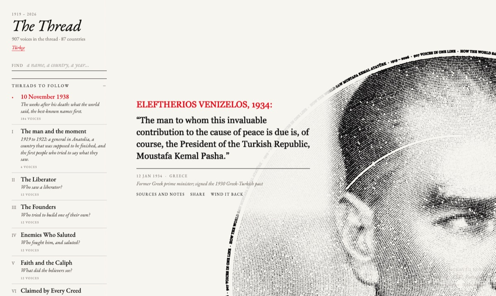

Türkçe için: [README.tr.md](README.tr.md)

# How the world saw Atatürk

[](https://the-long-thread.pages.dev)

An open archive of documented voices on Mustafa Kemal Atatürk, from 1919 to 2026: who said what about him, where they said it, the source it comes from, and an independent check of that source.

The voices are presidents, poets, generals, newspapers, parliaments, clerics, enemies and admirers. Each record is a small YAML file about one voice at one moment: the speaker, the date, a short neutral summary, the speaker's own words in the original language when the source prints them, the source, and the result of a separate checker re-opening that source.

**Exhibition:** [the-long-thread.pages.dev](https://the-long-thread.pages.dev) (The Thread, in Turkish and English). It is built from the files in this repository.

[](https://the-long-thread.pages.dev/#venizelos-1934-01-12)

Every voice has its own link. The one above is [the-long-thread.pages.dev/#venizelos-1934-01-12](https://the-long-thread.pages.dev/#venizelos-1934-01-12); the part after `#` is the record's `id`.

## Current size

| | |
|---|---|
| Records | 965 |
| Distinct voice names (people, papers, institutions, groups) | 793 |
| Present-day countries and territories (`country_now`) | 84, plus the European Union, the Council of Europe and UNESCO |
| Years covered | 1919 to 2026 (100 year folders; 1938 alone has 207 records) |
| Records with the speaker's own words (`quote`) | 838, in 30 languages |
| Records with a stored source check | 965 (all) |
| Records with a Turkish translation file | 965 (all) |

Source checks, by verdict:

| Verdict | Records | Share |
|---|---|---|
| `confirmed` | 767 | 79% |
| `partial` | 96 | 10% |
| `paraphrase-ok` | 57 | 6% |
| `secondary-only` | 29 | 3% |
| `unreachable` | 11 | 1% |
| `not-found` | 3 | under 1% |
| `contradicted` | 2 | under 1% |

The verdicts are explained in [data/README.md](data/README.md#verdicts).

959 records are shown in the exhibition. The other 6 are the 5 records whose check failed (`not-found`, `contradicted`) and 1 record of Atatürk speaking about himself (`voice_type: self`). They stay in the data.

Stance of the voice towards Atatürk (`polarity`): 511 admiring, 138 conflicted, 131 instrumental (praise that served the speaker's own agenda), 122 hostile, 63 witness (reported or attended, no stated view).

## What is in each folder

| Folder | Contents |
|---|---|
| `data/voices/<YYYY>/` | One file per record, `<id>.yaml`. `YYYY` is the year of the record's date. |
| `data/translations/tr/<YYYY>/` | Turkish text for each record, same file name. Machine-translated and marked as such. |
| `data/schema/` | JSON Schemas for a record and for a translation file. |
| `data/templates/voice.yaml` | The commented template for a new record. |
| `data/README.md` | The field reference: every field, its rule and its allowed values. |
| `vault/` | Research notes, one per person or event. Records point to them with the `node` field. |
| `research/` | The research question and method (`RESEARCH.md`), the search log (`HUNT.md`), every decision and correction (`LEDGER.md`), leads not yet done (`candidates/`) and the scripts used (`pipeline/`). |
| `tools/` | The validator (`tools/validate.mjs`), the new-record scaffolder (`tools/new-voice.mjs`) and the shared loader (`tools/lib/records.mjs`). |
| `viz/` | The exhibition (Vite and three.js). `viz/scripts/build-data.mjs` builds its data from `data/`. |

The records are split into year folders because GitHub shows at most 1,000 files in one folder.

## Method and principles

- **Extract, never add.** Every field must be supported by the cited source. Nothing is filled in from memory or general knowledge.
- **Quotes are verbatim, in the original language.** A French telegram is quoted in French, a Russian memoir in Russian. An English translation sits next to it in its own field.
- **Summaries are ours, and are marked as ours.** The `summary` field is a neutral paraphrase of at most 25 words. It is never presented as the speaker's words.
- **Every record is re-checked by someone other than its author.** The checker re-opens the cited source and records what they found in the `verification` block of the same file: the verdict, whether the quote was found, what was read, and how.
- **Admiring and hostile voices are both included.** A documented voice is recorded whatever its view. A hostile record states who said it, when, and in which source. It records the speaker's view, not the archive's.
- **Doubts are written down.** Second-hand chains go in `mediated_by`, uncertainties in `caveat`. Records whose check failed stay in the data but are not shown in the exhibition.
- **Turkish translations are machine-made and marked.** Each translation file says so in its first line and in `translated_by`. Corrections are welcome. Turkish originals are kept as they were printed.

## How to contribute

You can suggest a voice, report an error, check a record against its source or fix a Turkish translation. None of these needs Git or YAML: each has a form.

- **Open an issue** with one of the forms: [Suggest a voice / Söz öner](https://github.com/okanerturan/how-the-world-saw-ataturk/issues/new?template=suggest-voice.yml), [Correction / Düzeltme](https://github.com/okanerturan/how-the-world-saw-ataturk/issues/new?template=correction.yml), [Check a record / Kayıt doğrula](https://github.com/okanerturan/how-the-world-saw-ataturk/issues/new?template=check-record.yml), [Translation fix / Çeviri düzeltmesi](https://github.com/okanerturan/how-the-world-saw-ataturk/issues/new?template=translation.yml).
- **Or open a pull request** with a new or corrected file. This works in the browser.

**Looking for somewhere to start?** None of these needs special access or software:

- **Translate a quote into English.** About 300 quotes have no English translation yet; Turkish, French, Dutch, German, Chinese, Spanish and Japanese are the largest groups ([#6](https://github.com/okanerturan/how-the-world-saw-ataturk/issues/6)).
- **Read a Turkish translation against its English** and fix what sounds wrong. All the Turkish text was translated by machine ([#9](https://github.com/okanerturan/how-the-world-saw-ataturk/issues/9)).
- **Re-open a source and tell us what it says.** Every record needs a second reader, and the [Check a record / Kayıt doğrula](https://github.com/okanerturan/how-the-world-saw-ataturk/issues/new?template=check-record.yml) form takes a few minutes. Eleven records cite a source we could not open at all ([#5](https://github.com/okanerturan/how-the-world-saw-ataturk/issues/5)).
- **Find a text we know exists but could not reach:** Jinnah's statement on Atatürk's death ([#8](https://github.com/okanerturan/how-the-world-saw-ataturk/issues/8)), Hemingway's 1922 line in the Toronto Star ([#7](https://github.com/okanerturan/how-the-world-saw-ataturk/issues/7)), Roncalli's diary ([#4](https://github.com/okanerturan/how-the-world-saw-ataturk/issues/4)), Frunze's Ankara diary ([#3](https://github.com/okanerturan/how-the-world-saw-ataturk/issues/3)). More leads of this kind are in [`research/candidates/`](research/candidates/) and under "Open leads that need a person" in [`research/HUNT.md`](research/HUNT.md).

Read [CONTRIBUTING.md](CONTRIBUTING.md) first. It explains what counts as a voice, what evidence is needed, and how review works. The [code of conduct](CODE_OF_CONDUCT.md) applies in all project spaces.

## Using the data

The records are plain YAML files. You can read them directly, or load them with any YAML library. The fields are described in [data/README.md](data/README.md), and the JSON Schema is in `data/schema/voice.schema.json`.

To work with the tools you need Node.js 20 or later:

```sh
npm install
npm run validate   # check every record and translation file against the schema and the rules
npm run export     # write dist/voices.json and dist/voices.csv
```

`dist/voices.json` holds every record in one array, in date order, with the `verification` block reduced to its `verdict` and the record's file path added. `dist/voices.csv` has one row per record with the main fields, the quote and its translation, the first source and the verdict. It is UTF-8 with a byte-order mark, so spreadsheet programs show Turkish letters correctly. `dist/` is generated and is not committed.

**Licence.** The data, notes, summaries and translations (`data/`, `vault/`, `research/` apart from its scripts) are licensed under [CC BY 4.0](LICENSE-DATA.md). The code (`tools/`, `viz/`, `research/pipeline/`) is under the [MIT licence](LICENSE). Quotations remain the words of their speakers. They are reproduced as short quotations, each with its source. The photographs in `viz/public/photos/` are public domain or CC0; their credits are in `viz/public/photos/photos.json`.

## How to cite

> Okan Erturan, *How the world saw Atatürk: documented voices on Mustafa Kemal Atatürk, 1919–2026*, https://github.com/okanerturan/how-the-world-saw-ataturk (accessed 10 November 2026).

Replace the access date with the date you used it. To cite a single record, cite the original source named in its `sources` field, and add the record's file path, for example `data/voices/1921/lenin-aralov-1921.yaml`.

## Credits

Built by Okan Erturan. Much of the searching was done with AI research agents; every record was then re-checked against its source by a separate checker, and that check is stored in the record.
