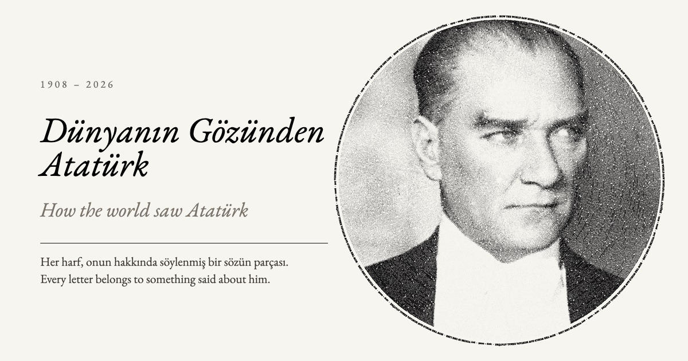
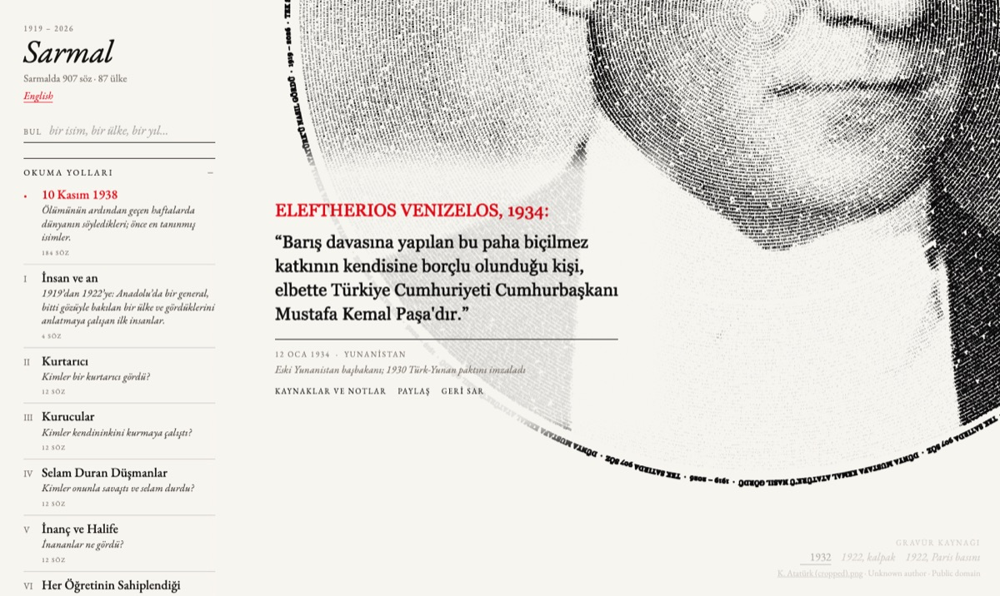

English: [README.md](README.md)

# Dünya Atatürk'ü nasıl gördü

[](https://the-long-thread.pages.dev)

1919'dan 2026'ya Mustafa Kemal Atatürk hakkında belgelenmiş sözlerden oluşan açık bir arşiv: onun hakkında kimin ne söylediği, nerede söylediği, bunun hangi kaynaktan geldiği ve o kaynağın bağımsız doğrulaması.

Sözler; devlet başkanlarından, şairlerden, generallerden, gazetelerden, parlamentolardan, din adamlarından, düşmanlardan ve hayranlardan geliyor. Her kayıt, belirli bir andaki tek bir sözü konu alan küçük bir YAML dosyasıdır: konuşmacı, tarih, kısa ve tarafsız bir özet, kaynakta yer alıyorsa konuşmacının orijinal dildeki kendi sözleri, kaynak ve bu kaynağı yeniden açıp inceleyen bağımsız bir doğrulayıcının ulaştığı sonuç.

**Sergi:** [the-long-thread.pages.dev](https://the-long-thread.pages.dev) (Sarmal, Türkçe ve İngilizce). Bu depodaki dosyalardan oluşturulmuştur.

[](https://the-long-thread.pages.dev/?lang=tr#venizelos-1934-01-12)

Her sözün kendi bağlantısı vardır. Yukarıdaki söz [the-long-thread.pages.dev/#venizelos-1934-01-12](https://the-long-thread.pages.dev/?lang=tr#venizelos-1934-01-12) adresindedir; `#` işaretinden sonraki kısım kaydın `id` değeridir.

## Mevcut boyut

| | |
|---|---|
| Kayıtlar | 964 |
| Farklı söz sahipleri (kişiler, gazeteler, kurumlar, gruplar) | 792 |
| Günümüz ülkeleri ve bölgeleri (`country_now`) | 84; ayrıca Avrupa Birliği, Avrupa Konseyi ve UNESCO |
| Kapsanan yıllar | 1919 – 2026 (100 yıl klasörü; yalnızca 1938'de 207 kayıt vardır) |
| Konuşmacının kendi sözlerini (`quote`) içeren kayıtlar | 30 dilde 837 |
| Kayıtlı kaynak doğrulaması bulunan kayıtlar | 964 (tümü) |
| Türkçe çeviri dosyası bulunan kayıtlar | 964 (tümü) |

Sonuca göre kaynak doğrulamaları:

| Sonuç | Kayıtlar | Oran |
|---|---|---|
| `confirmed` | 765 | %79 |
| `partial` | 97 | %10 |
| `paraphrase-ok` | 57 | %6 |
| `secondary-only` | 29 | %3 |
| `unreachable` | 11 | %1 |
| `not-found` | 3 | %1'in altında |
| `contradicted` | 2 | %1'in altında |

Sonuçların açıklamaları [data/README.md](data/README.md#verdicts) dosyasındadır.

Sergide 958 kayıt gösterilmektedir. Diğer 6 kayıt ise doğrulaması başarısız olan (`not-found`, `contradicted`) 5 kayıt ile Atatürk'ün kendisi hakkında konuştuğu (`voice_type: self`) 1 kayıttır. Bunlar veri setinde kalmaya devam eder.

Söz sahibinin Atatürk'e karşı tutumu (`polarity`): 510 hayranlık duyan (admiring), 138 ikircikli (conflicted), 131 araçsal (instrumental; konuşmacının kendi gündemine hizmet eden övgü), 122 düşmanca (hostile), 63 tanık (witness; bildiren veya katılan, belirtilmiş bir görüşü olmayan).

## Klasörlerin içeriği

| Klasör | İçerik |
|---|---|
| `data/voices/<YYYY>/` | Her kayıt için bir dosya, `<id>.yaml`. `YYYY`, kaydın tarihindeki yıldır. |
| `data/translations/tr/<YYYY>/` | Her kayıt için aynı dosya adıyla Türkçe metin. Makine çevirisidir ve bu şekilde işaretlenmiştir. |
| `data/schema/` | Kayıt ve çeviri dosyaları için JSON Şemaları. |
| `data/templates/voice.yaml` | Yeni bir kayıt için açıklamalı şablon. |
| `data/README.md` | Alan başvuru kılavuzu: her alan, kuralı ve izin verilen değerleri. |
| `vault/` | Her kişi veya olay için bir adet olmak üzere araştırma notları. Kayıtlar `node` alanıyla bunlara işaret eder. |
| `research/` | Araştırma sorusu ve yöntemi (`RESEARCH.md`), arama günlüğü (`HUNT.md`), her karar ve düzeltme (`LEDGER.md`), henüz tamamlanmamış ipuçları (`candidates/`) ve kullanılan betikler (`pipeline/`). |
| `tools/` | Doğrulayıcı (`tools/validate.mjs`), yeni kayıt taslak oluşturucusu (`tools/new-voice.mjs`) ve ortak yükleyici (`tools/lib/records.mjs`). |
| `viz/` | Sergi (Vite ve three.js). `viz/scripts/build-data.mjs` verisini `data/` klasöründen oluşturur. |

GitHub bir klasörde en fazla 1.000 dosya gösterdiği için kayıtlar yıl klasörlerine ayrılmıştır.

## Yöntem ve ilkeler

- **Kaynaktan çıkarın, asla ekleme yapmayın.** Her alan belirtilen kaynak tarafından desteklenmelidir. Hiçbir şey hafızadan veya genel kültürden doldurulmaz.
- **Alıntılar birebirdir ve orijinal dilindedir.** Fransızca bir telgraf Fransızca, Rusça bir anı Rusça alıntılanır. İngilizce çevirisi kendi alanında hemen yanında yer alır.
- **Özetler bize aittir ve bizim olarak işaretlenmiştir.** `summary` alanı en fazla 25 kelimelik tarafsız bir açımlamadır. Asla konuşmacının kendi sözleriymiş gibi sunulmaz.
- **Her kayıt, yazarı dışında biri tarafından yeniden doğrulanır.** Doğrulayıcı, belirtilen kaynağı yeniden açar ve bulduklarını aynı dosyanın `verification` bloğuna kaydeder: sonuç, alıntının bulunup bulunmadığı, neyin okunduğu ve nasıl okunduğu.
- **Hem hayranlık dolu hem de düşmanca sözler dahil edilir.** Belgelenmiş bir söz, görüşü ne olursa olsun kaydedilir. Düşmanca bir kayıt bunu kimin, ne zaman ve hangi kaynakta söylediğini belirtir. Arşivin değil, konuşmacının görüşünü kaydeder.
- **Şüpheler kayda geçirilir.** İkinci elden aktarım zincirleri `mediated_by` alanına, belirsizlikler `caveat` alanına yazılır. Doğrulaması başarısız olan kayıtlar veri setinde kalır ancak sergide gösterilmez.
- **Türkçe çeviriler makine yapımıdır ve bu şekilde işaretlenmiştir.** Her çeviri dosyası bunu ilk satırında ve `translated_by` alanında belirtir. Düzeltmeler memnuniyetle karşılanır. Orijinali Türkçe olan metinler basıldıkları haliyle korunur.

## Nasıl katkıda bulunabilirsiniz

Bir söz önerebilir, bir hata bildirebilir veya bir Türkçe çeviriyi düzeltebilirsiniz. İlk ikisi için Git veya YAML bilmenize gerek yoktur.

- Formlardan biriyle **bir issue (konu) açın**: [Söz öner / Suggest a voice](https://github.com/okanerturan/how-the-world-saw-ataturk/issues/new?template=suggest-voice.yml), [Düzeltme / Correction](https://github.com/okanerturan/how-the-world-saw-ataturk/issues/new?template=correction.yml), [Çeviri düzeltmesi / Translation fix](https://github.com/okanerturan/how-the-world-saw-ataturk/issues/new?template=translation.yml).
- **Veya yeni ya da düzeltilmiş bir dosyayla bir pull request (çekme isteği) açın.** Bu işlemi doğrudan tarayıcıda yapabilirsiniz.

Önce [CONTRIBUTING.tr.md](CONTRIBUTING.tr.md) dosyasını okuyun. Orada neyin bir söz sayıldığı, hangi kanıtların gerektiği ve inceleme sürecinin nasıl işlediği açıklanmaktadır. Tüm proje alanlarında [davranış kuralları](CODE_OF_CONDUCT.md) geçerlidir.

## Veriyi kullanma

Kayıtlar düz YAML dosyalarıdır. Bunları doğrudan okuyabilir veya herhangi bir YAML kütüphanesiyle yükleyebilirsiniz. Alanlar [data/README.md](data/README.md) dosyasında açıklanmıştır; JSON Şeması ise `data/schema/voice.schema.json` içindedir.

Araçlarla çalışmak için Node.js 20 veya daha yeni bir sürüm gerekir:

```sh
npm install
npm run validate   # check every record and translation file against the schema and the rules
npm run export     # write dist/voices.json and dist/voices.csv
```

`dist/voices.json`, `verification` bloğu yalnızca `verdict` değerine indirgenmiş ve kaydın dosya yolu eklenmiş olarak tüm kayıtları tarih sırasına göre tek bir dizide tutar. `dist/voices.csv` ise ana alanları, alıntıyı ve çevirisini, ilk kaynağı ve doğrulama sonucunu içeren, her kayıt için bir satırdan oluşan dosyadır. Byte-order mark (BOM) içeren UTF-8 biçimindedir; böylece hesap tablosu programları Türkçe harfleri doğru gösterir. `dist/` klasörü otomatik oluşturulur ve depoya işlenmez (commit edilmez).

**Lisans.** Veriler, notlar, özetler ve çeviriler (`data/`, `vault/`, betikleri hariç `research/`) [CC BY 4.0](LICENSE-DATA.md) lisansı altındadır. Kodlar (`tools/`, `viz/`, `research/pipeline/`) [MIT lisansı](LICENSE) altındadır. Alıntılar konuşmacılarının kendi sözleri olmaya devam eder; her biri kaynağıyla birlikte kısa alıntılar olarak yeniden üretilmiştir. `viz/public/photos/` içindeki fotoğraflar kamu malıdır (public domain) veya CC0 lisanslıdır; kaynak bilgileri `viz/public/photos/photos.json` dosyasındadır.

## Nasıl kaynak gösterilir

> Okan Erturan, *How the world saw Atatürk: documented voices on Mustafa Kemal Atatürk, 1919–2026*, https://github.com/okanerturan/how-the-world-saw-ataturk (erişim tarihi: 10 Kasım 2026).

Erişim tarihini veriyi kullandığınız tarihle değiştirin. Tek bir kaydı kaynak göstermek için, kaydın `sources` alanında adı geçen orijinal kaynağı belirtin ve kaydın dosya yolunu ekleyin; örneğin `data/voices/1921/lenin-aralov-1921.yaml`.

## Emeği geçenler

Okan Erturan tarafından oluşturulmuştur. Aramaların büyük kısmı yapay zekâ araştırma ajanlarıyla yapılmış; ardından her kayıt ayrı bir doğrulayıcı tarafından kaynağıyla karşılaştırılarak yeniden doğrulanmış ve bu doğrulama kaydın içine işlenmiştir.
